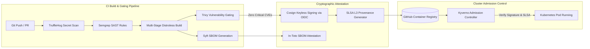

# Zero-Trust DevSecOps Pipeline with Software Supply Chain Security (SLSA Compliant)

[](https://github.com/Bhomesh/zero-trust-devsecops-pipeline/actions/workflows/security-pipeline.yml)
[](https://opensource.org/licenses/MIT)
[](https://slsa.dev)
[](https://sigstore.dev)
[](https://kyverno.io)
[](https://trivy.dev)

A bank-grade, Zero-Trust software supply chain security framework and automated DevSecOps pipeline achieving **SLSA Level 3 compliance**, keyless cryptographic container signing via Sigstore Cosign, SBOM generation, secret detection, and runtime admission control via Kyverno and OPA Gatekeeper.

---

## 🌟 Architecture & Pipeline Workflow



---

## 🛡️ Enterprise Security Stack

- **Secret Scanning (TruffleHog OSS)**: Deep git history analysis detecting verified live tokens and credentials.
- **Static Application Security Testing (Semgrep)**: High-speed SAST rules hunting for hardcoded credentials, insecure TLS bypasses, and command injection.
- **Vulnerability Scanning & Gating (Trivy)**: Enforces hard stop on Critical CVEs (> 0), CVSS scoring, CISA KEV exploit checks, and signed time-bound exceptions.
- **Software Bill of Materials (Syft)**: Generates CycloneDX and SPDX SBOMs attached directly to container image OCI layers.
- **Cryptographic Keyless Signing (Sigstore Cosign)**: Eliminates long-lived private keys by using short-lived X.509 certificates tied to GitHub Actions OIDC identity.
- **SLSA Level 3 Provenance**: Non-falsifiable build attestations recording source repository commit, builder identity, and dependency hashes.
- **Admission Enforcement (Kyverno & Gatekeeper)**: Enforces image signature verification, SLSA provenance validation, non-root user (UID >= 10000), read-only root filesystems, and registry restrictions before pod scheduling.

---

## 📂 Repository Structure

```text
├── .github/workflows/
│   ├── security-pipeline.yml         # End-to-end Zero-Trust DevSecOps pipeline
│   └── ci.yml                        # Automated policy & unit test suite
├── Makefile                          # Local test and scan automation commands
├── policies/
│   ├── cve_waivers.yaml              # Time-bound, approved vulnerability waivers
│   ├── license_policy.yaml           # Permitted vs banned open-source licenses
│   ├── kyverno/                      # Kyverno ClusterPolicies
│   │   ├── require-image-signature.yaml
│   │   ├── require-slsa-provenance.yaml
│   │   ├── disallow-root-and-privileged.yaml
│   │   ├── require-image-digest.yaml
│   │   └── allowed-registries.yaml
│   ├── gatekeeper-opa/               # OPA Gatekeeper constraint templates
│   ├── semgrep/                      # Custom SAST security rules
│   │   └── rules.yaml
│   └── trufflehog/                   # Secret scanner configuration
│       └── trufflehog.yaml
├── sample-app/                       # Hardened reference microservice
│   ├── Dockerfile                    # Multi-stage distroless minimal build
│   ├── main.py                       # Secure Python application
│   └── requirements.txt              # Pinned dependencies
├── src/                              # Policy engine & supply chain verification tools
│   ├── supply_chain_verifier.py      # SLSA L3 & Cosign signature validator
│   ├── cve_gatekeeper.py             # Trivy CVSS & CISA KEV policy engine
│   ├── secret_scanner.py             # TruffleHog parser and evaluator
│   └── sbom_analyzer.py              # CycloneDX/SPDX license auditor
├── tests/                            # Unit and regression test suite
└── docs/
    ├── THREAT_MODEL.md               # STRIDE supply chain threat analysis
    └── SLSA_COMPLIANCE_MATRIX.md     # Detailed SLSA Level 1-3 control matrix
```

---

## 🚀 Quickstart Guide

### 1. Execute Unit & Regression Test Suite
```bash
make test
```

### 2. Validate Policy Manifests
```bash
make test-policies
```

### 3. Evaluate Container Vulnerability Gating Locally
```bash
python3 src/cve_gatekeeper.py
```

### 4. Verify SLSA Level 3 Attestation
```bash
python3 -c "
from src.supply_chain_verifier import SupplyChainVerifier
verifier = SupplyChainVerifier()
print(verifier.verify_cosign_signature('ghcr.io/bhomesh/secure-service@sha256:' + 'a'*64))
"
```

---

## 📜 Compliance & Threat Defenses

| Threat Vector | Defense Mechanism | Standard |
|---|---|---|
| Malicious Package Insertion | Automated Syft SBOM + License Compliance Audit | NIST SP 800-218 |
| Tampered CI Artifact | SLSA Level 3 Provenance Attestation | SLSA v1.0 |
| Registry Poisoning | Keyless Cosign Signing with Sigstore Rekor Log | Executive Order 14028 |
| Active Exploits in Production | CISA Known Exploited Vulnerabilities (KEV) Gate | CISA BOD 22-01 |
| Container Breakout | Non-Root Distroless Base + Kyverno PSS Restricted | CIS Kubernetes Benchmark |

---

## 📄 License
This project is licensed under the [MIT License](LICENSE).
