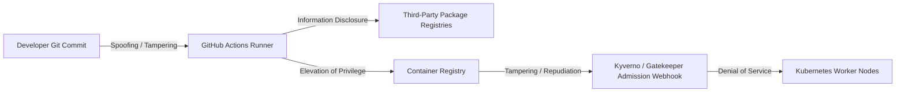

# Software Supply Chain Threat Model (STRIDE)

## Objective
Apply the STRIDE threat modeling framework to container build, code ingestion, artifact signing, and Kubernetes runtime admission.

## Threat Matrix & Compensating Controls

| STRIDE Category | Threat Description | Attack Vector | Zero-Trust Compensating Control |
|---|---|---|---|
| **Spoofing** | Compromised developer identity commits malicious code | Leaked personal access token or SSH key | Enforced branch protection, mandatory signed commits (GPG/SSH), TruffleHog git scanning. |
| **Tampering** | CI runner executes unverified build script or modifies binary | Compromised runner VM or runner hijacking | SLSA Level 3 builder isolation via `slsa-github-generator`, build provenance attestation. |
| **Repudiation** | Deployer denies originating rogue container image in production | Untracked deployment to Kubernetes | Cosign keyless cryptographic signing with Sigstore Rekor transparency log. |
| **Information Disclosure** | Cloud credentials or database tokens leaked in container layers | Hardcoded `.env` files or secret variables | Multi-stage distroless build, automated Semgrep SAST rules, TruffleHog verified detector. |
| **Denial of Service** | Upstream dependency introduces critical vulnerability | Log4Shell / HTTP/2 Rapid Reset exploit | Trivy vulnerability scan gating (Critical = 0), automated CISA KEV blocking. |
| **Elevation of Privilege** | Container breaks out to node kernel as root | Privileged container or host volume mount | Kyverno PSS policy (`disallow-root-and-privileged`), nonroot Distroless UID 65532. |
